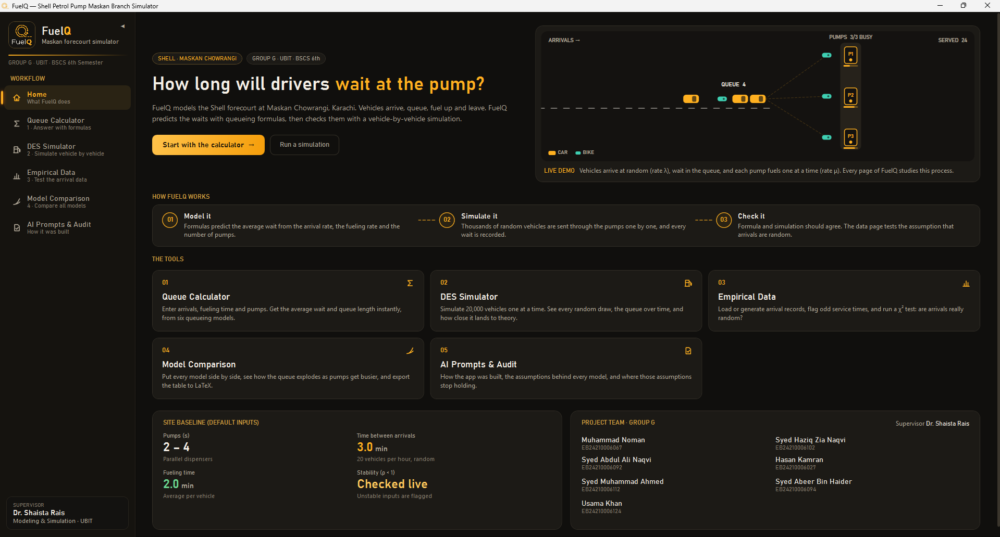
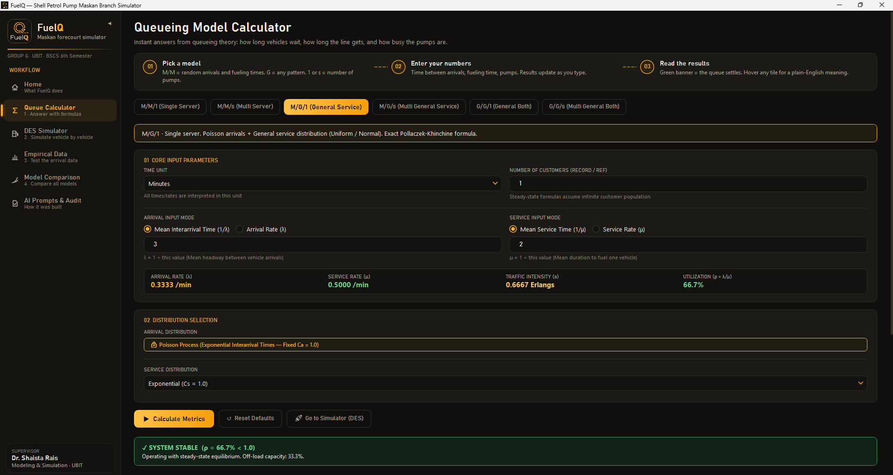
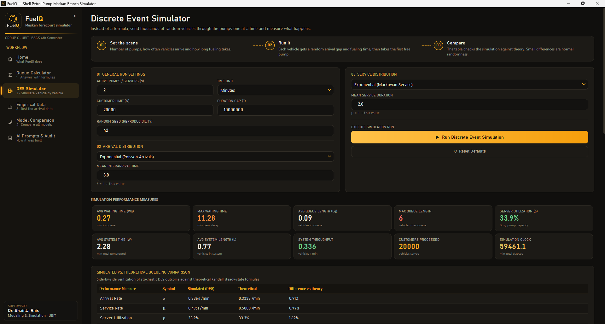
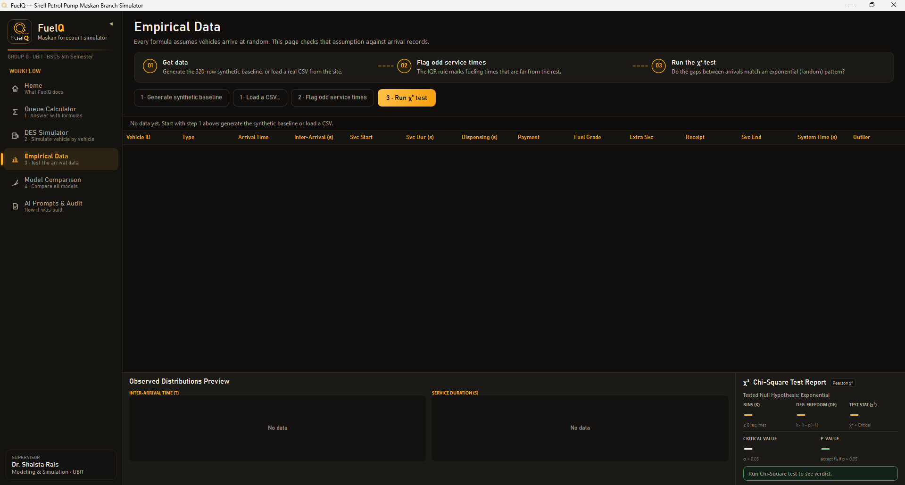
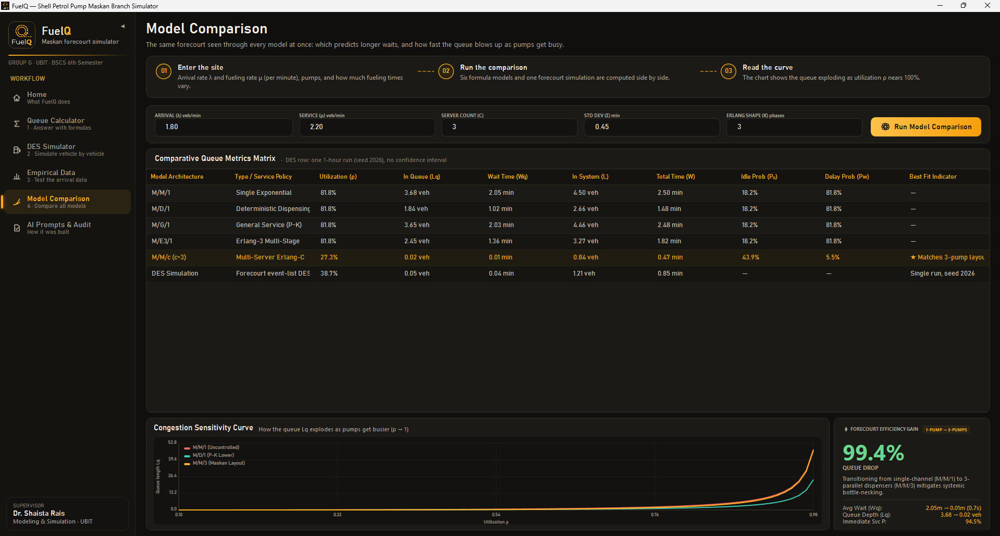

<div align="center">


# FuelQ — Forecourt Queueing & Simulation Studio

**A high-performance Windows desktop application built with WPF and .NET 10 for the Modeling & Simulation semester project (Group G, BSCS 6th Semester, UBIT, University of Karachi).**

*Models, analyzes, and simulates the multi-server stochastic vehicle queuing system at the Shell Petrol Pump forecourt located at Maskan Chowrangi, Gulshan-e-Iqbal, Karachi.*

[](Tests/FuelQ.Tests)
[](https://dotnet.microsoft.com/)
[](https://learn.microsoft.com/en-us/dotnet/csharp/)
[](https://learn.microsoft.com/en-us/dotnet/desktop/wpf/)
[](LICENSE)
[](FuelQ.csproj)

<p>
  <a href="#setup">Setup</a> ·
  <a href="#preview">Preview</a> ·
  <a href="#features">Features</a> ·
  <a href="#formulas">Formulas</a> ·
  <a href="#architecture">Architecture</a> ·
  <a href="#testing">Testing</a>
</p>

</div>

---

<a id="setup"></a>

## 🚀 How to Set Up & Run (Beginner-Friendly Guide)

> [!NOTE]
> **Windows Only:** The FuelQ desktop application is built with **WPF (`net10.0-windows`)** and runs **only on Windows** (Windows 10 / 11). *(The CLI test suite in `Tests/FuelQ.Tests` targets `net10.0` and works cross-platform.)*

If you have downloaded or cloned this project from GitHub and are using **VS Code** (or Windows PowerShell), follow these simple steps to get the app running:

---

### Step 1: Install C# & .NET (If you don't have C# installed)

To run any C# program, your computer needs the free **.NET SDK** from Microsoft.

1. **Install via PowerShell (Recommended & Fastest):**
   Open PowerShell as Administrator and run:
   ```powershell
   winget install Microsoft.DotNet.SDK.10
   ```
   *(Alternatively, download the official installer directly from the [Microsoft .NET Download Portal](https://dotnet.microsoft.com/download)).*

2. **Verify Installation:**
   Close and re-open your terminal or VS Code, then type:
   ```bash
   dotnet --version
   ```
   If it displays a version number (e.g., `10.x.x`), C# and .NET are ready!

---

### Step 2: Set Up VS Code

1. Open **Visual Studio Code**.
2. Press `Ctrl + Shift + X` (or click the Extensions icon on the left).
3. Search for **C#** (by Microsoft) and click **Install**.

---

### Step 3: Clone, Open, and Run FuelQ

1. **Clone (or Download) the Repository:**
   Open PowerShell or your terminal and run:
   ```bash
   git clone https://github.com/syedhaziqzia/fuelq-queue-simulator.git
   cd fuelq-queue-simulator
   ```
   *(Or click **Code → Download ZIP** on GitHub and extract the folder.)*

2. **Open the Project Folder:**
   In VS Code, go to **File → Open Folder...** and select the cloned or downloaded `fuelq-queue-simulator` folder.

3. **Open the Integrated Terminal:**
   Press ``Ctrl + ` `` (backtick) or go to **Terminal → New Terminal**.

4. **Run the Project:**
   Type the following command and press **Enter**:
   ```bash
   dotnet run
   ```

   *The project will automatically compile and launch the FuelQ desktop application window.*

> **📦 Dependencies Note:** **Zero external packages or installations needed.** Everything in FuelQ (including custom charts, statistical distributions, and the simulation engine) is written in native C# / WPF.

---

<a id="preview"></a>

## 🖼️ Application Preview

### 1. Home Dashboard & Live Forecourt Demo
*Live animated Shell Maskan forecourt demonstration, workflow guide, tool navigation cards, site baseline, and Group G team roster.*



<details>
<summary><strong>2. Queueing Model Calculator</strong> — Analytical solvers across 6 Kendall models (M/M/1 through G/G/s)</summary>

*Analytical solvers across 6 Kendall models (M/M/1, M/M/s, M/G/1, M/G/s, G/G/1, G/G/s) with live traffic intensity, utilization, and stability badges.*



</details>

<details>
<summary><strong>3. Discrete Event Simulator (DES)</strong> — Vehicle-by-vehicle stochastic simulation &amp; theoretical verification</summary>

*Event-driven stochastic simulation engine with custom distributions (Exponential, Normal, Uniform, Gamma), KPI cards, and theoretical verification.*



</details>

<details>
<summary><strong>4. Empirical Data &amp; Chi-Square Goodness-of-Fit</strong> — 320-vehicle dataset, IQR outliers &amp; Pearson χ² test</summary>

*320-vehicle dataset table, IQR outlier detection, observed distribution histograms, and Pearson Chi-Square (χ²) test report.*



</details>

<details>
<summary><strong>5. Model Comparison &amp; Congestion Sensitivity</strong> — Side-by-side matrix &amp; Lq vs. ρ curve</summary>

*Side-by-side analytical vs. DES simulation matrix, Lq vs. ρ congestion sensitivity curve, and forecourt efficiency gain metrics.*



</details>

---

<a id="features"></a>

## 🌟 Key Features

* **Analytical Queueing Solvers:** Exact and approximation solutions for 8 Kendall models: **M/M/1**, **M/M/s** (Erlang-C), **M/G/1** (Pollaczek-Khinchine), **M/G/s** (Allen-Cunneen), **G/G/1** (Kingman), **G/G/s**, **M/D/1**, and **M/E<sub>k</sub>/1**.
* **Simulation Table (DES Simulator page):** Multi-server FCFS simulation table (Lindley recursion) supporting Exponential, Normal, Uniform, and Gamma distributions. Every time is generated by inverse transform from the random number shown in the table, so each row can be checked by hand.
* **Forecourt-Specific Modeling:** Event-list DES for Shell Maskan with a 70/30 motorcycle/car fleet mix (a model parameter) and cash vs. card lane segregation, with shortest-queue pump routing.
* **Observation Data & Goodness-of-Fit:** 320-vehicle **synthetic** baseline dataset (generated, not field data; load a real CSV to test the site), IQR outlier detection on service times, and a Chi-Square (χ²) Goodness-of-Fit test (α = 0.05).
* **Model Benchmarking & Sensitivity:** Side-by-side analytical vs. simulated validation, Lq vs. ρ sensitivity curves, and one-click LaTeX table exports.
* **AI Prompts & Engineering Audit:** Complete transparency log of prompt engineering and architectural validation.

---

<a id="formulas"></a>

## 📐 Mathematical Formulas Reference

| Kendall Model | Queue Length (L<sub>q</sub>) / Wait Time (W<sub>q</sub>) Formula | Classification |
| :--- | :--- | :--- |
| **M/M/1** | `Lq = ρ² / (1 - ρ)` | Exact closed-form |
| **M/M/s** | `Lq = [C(s, a) · ρ] / (1 - ρ)` *(where C(s, a) is Erlang-C)* | Exact closed-form |
| **M/G/1** | `Wq = [λ · (σ² + 1/μ²)] / [2 · (1 - ρ)]` *(Pollaczek-Khinchine)* | Exact mean-value |
| **M/G/s** | `Wq ≈ [(1 + Cs²) / 2] · Wq(M/M/s)` *(Allen-Cunneen)* | Approximation |
| **G/G/1** | `Wq ≈ [(Ca² + Cs²) / 2] · [ρ / (1 - ρ)] · (1 / μ)` *(Kingman)* | Heavy-traffic approximation |
| **G/G/s** | `Wq ≈ [(Ca² + Cs²) / 2] · Wq(M/M/s)` *(Allen-Cunneen)* | Approximation |
| **M/D/1** | `Lq = ρ² / [2 · (1 - ρ)]` *(Deterministic service, σ = 0)* | Exact closed-form |
| **M/Ek/1** | `Lq = [(1 + k) / (2k)] · [ρ² / (1 - ρ)]` *(Erlang-k service)* | Exact closed-form |

---

<a id="architecture"></a>

## 🔄 Architecture & Data Flow

<div align="center">
<table><tr><td>

```text
  ┌──────────────────────────┐
  │      Empirical Data      │
  │ (CSV / 320-Row Synthetic)│
  └────────────┬─────────────┘
               │
               ▼
  ┌──────────────────────────┐
  │      IQR Outliers &      │
  │     Pearson χ² Test      │
  └────────────┬─────────────┘
               │
       ┌───────┴───────┐
       │               │
       ▼               ▼
┌──────────────┐ ┌──────────────┐
│  Analytical  │ │  DES Engine  │
│   Solvers    │ │   (Table &   │
│(M/M/1..G/G/s)│ │  Forecourt)  │
└──────┬───────┘ └──────┬───────┘
       │                │
       └───────┬────────┘
               │
               ▼
  ┌──────────────────────────┐
  │     Model Comparison     │
  │      & LaTeX Export      │
  └──────────────────────────┘
```

</td></tr></table>
</div>

---

## 🏗️ Repository Structure

```
fuelq-queue-simulator/
├── Assets/                        # Visual assets (app icon, logo, UI screenshots)
│   ├── AppIcon.ico
│   ├── AppLogo.jpg
│   ├── AppLogo-rounded.png
│   └── screenshot-01..05.png
├── Controls/                      # Custom WPF DrawingContext vector charts
│   └── SimpleWpfChart.cs
├── Distributions/                 # Exponential, Normal (Marsaglia polar / inverse CDF),
│                                  # Uniform, Gamma, Erlang, Poisson samplers
├── Models/                        # Analytical queue calculators & QueueMetrics record
├── Simulation/                    # GeneralDESimulator (simulation table) & ForecourtSimulator (event-list DES)
├── Statistics/                    # Dataset generator/loader, IQR outliers, Chi-Square test
├── Tests/FuelQ.Tests/             # Zero-dependency verification suite (see Testing)
├── Views/                         # UI Views (XAML & code-behind)
├── App.xaml / App.xaml.cs         # Application entry point & dark theme styles
├── MainWindow.xaml / .cs          # Shell navigation host & sidebar
└── FuelQ.csproj                   # Project configuration (.NET 10 WPF)
```

---

<a id="testing"></a>

## 🧪 Testing

The calculation and simulation logic has an automated verification suite that needs no extra packages. From the `fuelq-queue-simulator` folder, run:

```bash
dotnet run --project Tests/FuelQ.Tests
```

It prints `PASS` / `FAIL` for each check and ends with a summary (exit code 0 means everything passed). The checks cover:

* the analytical formulas against known textbook values;
* the simulator against queueing theory, including queue lengths, the Q(t) timeline and Little's Law;
* the inverse-transform samplers and the χ² test;
* the numbers quoted on the Audit page, which must match what the code actually computes.

---

## 👥 Academic Context & Team Credits

| Attribute | Information |
| :--- | :--- |
| **Course** | Modeling & Simulation |
| **Supervisor** | **Dr. Shaista Rais** |
| **Institution** | **Department of Computer Science (UBIT), University of Karachi** |
| **Semester** | BSCS 6th Semester |
| **Lead Developer & Architect** | **Syed Haziq Zia Naqvi** |
| **Project Group (Group G)** | • Muhammad Noman<br>• Syed Abdul Ali Naqvi<br>• Hasan Kamran<br>• Syed Muhammad Ahmed<br>• Syed Abeer Bin Haider<br>• Usama Khan |
| **Study Site** | Shell Petrol Pump, Maskan Chowrangi, Gulshan-e-Iqbal, Karachi |

---

## 📄 License & Specifications

This project is licensed under the [MIT License](LICENSE).
Feel free to use and adapt this project for academic and educational purposes.
